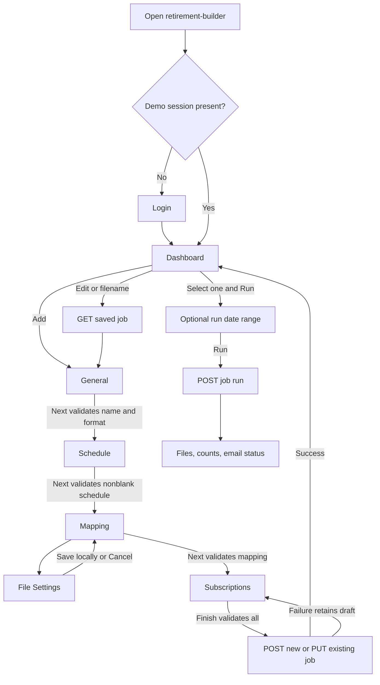

# Complete user journey

## Routes and screens

There are **5 core screens**: Dashboard, General, Schedule, Mapping and Subscriptions. File Settings and Run job are **2 additional dialogs**. Login is an adjacent screen, making **8 distinct views including login**. Add and Edit reuse the same four step components; they are not eight different screen implementations. [frontend/src/App.tsx:85](/Users/apple/Desktop/ECS/frontend/src/App.tsx:85), [frontend/src/App.tsx:568](/Users/apple/Desktop/ECS/frontend/src/App.tsx:568).

| View | Add path | Edit path | Main function |
|---|---|---|---|
| Dashboard | `/retirement-builder` | Same | `Dashboard` [frontend/src/App.tsx:572](/Users/apple/Desktop/ECS/frontend/src/App.tsx:572) |
| General | `/jobs/new` | `/jobs/edit/general` | `GeneralStep` [frontend/src/App.tsx:809](/Users/apple/Desktop/ECS/frontend/src/App.tsx:809) |
| Schedule | `/jobs/new/schedule` | `/jobs/edit/schedule` | `ScheduleStep` [frontend/src/App.tsx:900](/Users/apple/Desktop/ECS/frontend/src/App.tsx:900) |
| Mapping | `/jobs/new/mapping` | `/jobs/edit/mapping` | `MappingStep` [frontend/src/App.tsx:966](/Users/apple/Desktop/ECS/frontend/src/App.tsx:966) |
| Subscriptions | `/jobs/new/subscriptions` | `/jobs/edit/subscriptions` | `SubscriptionsStep` [frontend/src/App.tsx:1050](/Users/apple/Desktop/ECS/frontend/src/App.tsx:1050) |
| File Settings | Modal on Mapping | Same | `FileSettingsModal` [frontend/src/App.tsx:1136](/Users/apple/Desktop/ECS/frontend/src/App.tsx:1136) |
| Run job | Dialog on Dashboard | Same | `RunDateDialog` [frontend/src/App.tsx:752](/Users/apple/Desktop/ECS/frontend/src/App.tsx:752) |
| Login, adjacent | `/login` | Same | `LoginPage` [frontend/src/LoginPage.tsx:13](/Users/apple/Desktop/ECS/frontend/src/LoginPage.tsx:13) |

## 1. Open the feature

`RootRoutes` reads the demo authentication flag from sessionStorage. Without it, the route redirects to Login. Login checks locally against constants, then sets the flag; it makes no authentication API call. No credentials are reproduced here. The backend feature handlers do not contain corresponding authentication dependencies. [frontend/src/main.tsx:9](/Users/apple/Desktop/ECS/frontend/src/main.tsx:9), [frontend/src/LoginPage.tsx:20](/Users/apple/Desktop/ECS/frontend/src/LoginPage.tsx:20), [backend/app/routers/retirement_builder.py:931](/Users/apple/Desktop/ECS/backend/app/routers/retirement_builder.py:931).

The frontend uses `/api/v1`. Vite proxies `/api` to the backend. Configured Vite port is 5173; the requested 5174 was reachable during this investigation. Port fallback as the specific reason for 5174 is **NOT VERIFIED**. [frontend/src/App.tsx:41](/Users/apple/Desktop/ECS/frontend/src/App.tsx:41), [frontend/vite.config.ts:4](/Users/apple/Desktop/ECS/frontend/vite.config.ts:4), [HTTP evidence](evidence/read-only-http.json).

## 2. Dashboard

The page requests jobs immediately and every 5 seconds while the document is visible. Initial failure displays a load error; later polling failure retains the old table. The backend list includes enabled jobs only and requires a matching schedule row through an inner join. Disabled records do not appear. [frontend/src/App.tsx:319](/Users/apple/Desktop/ECS/frontend/src/App.tsx:319), [backend/query.brl:693](/Users/apple/Desktop/ECS/backend/query.brl:693).

Each of ten columns has a substring filter and sort button. These run locally, not through a filter API. Pagination has ten jobs per page. Sort uses a numeric-aware string collator, including the displayed time strings; it is not a dedicated time-of-day comparison. Select one visible row to enable Edit/Run. Selecting two disables them. Select-all means current visible page. Changing a filter, sort, or page clears selection. Filename opens Edit directly. [frontend/src/App.tsx:569](/Users/apple/Desktop/ECS/frontend/src/App.tsx:569), [frontend/src/App.tsx:596](/Users/apple/Desktop/ECS/frontend/src/App.tsx:596), [frontend/src/App.tsx:622](/Users/apple/Desktop/ECS/frontend/src/App.tsx:622), [frontend/src/App.tsx:689](/Users/apple/Desktop/ECS/frontend/src/App.tsx:689).

Add resets state and opens General. Edit fetches the full job before showing its fields. A failed edit fetch shows Retry; there is no editable form while awaiting the requested job. The wizard step tabs are disabled during that wait. [frontend/src/App.tsx:414](/Users/apple/Desktop/ECS/frontend/src/App.tsx:414), [frontend/src/App.tsx:435](/Users/apple/Desktop/ECS/frontend/src/App.tsx:435), [frontend/src/App.tsx:522](/Users/apple/Desktop/ECS/frontend/src/App.tsx:522), [frontend/src/App.tsx:568](/Users/apple/Desktop/ECS/frontend/src/App.tsx:568).

## 3. General

Enter mandatory File Name (nonblank, at most 255 characters) and File Format. Optional: Description, Output File Name Format, Store Results to Table, and Excel mapping workbook. Enable is visible only in Edit; new jobs start enabled. The output-name selection starts blank but saves as `FILENAME` through backend normalization. Workbook import replaces current mapping rows and never uploads its bytes. [frontend/src/retirementBuilder.ts:52](/Users/apple/Desktop/ECS/frontend/src/retirementBuilder.ts:52), [frontend/src/App.tsx:377](/Users/apple/Desktop/ECS/frontend/src/App.tsx:377), [frontend/src/App.tsx:837](/Users/apple/Desktop/ECS/frontend/src/App.tsx:837), [backend/app/routers/retirement_builder.py:983](/Users/apple/Desktop/ECS/backend/app/routers/retirement_builder.py:983), [backend/app/retirement_results.py:159](/Users/apple/Desktop/ECS/backend/app/retirement_results.py:159).

Next validates General and opens Schedule. During workbook parsing Next is disabled, and forward tab navigation is blocked. A bad workbook shows an error but leaves earlier successful mappings intact. Cancel returns to Dashboard. No job POST/PUT occurs on Next, Cancel, checkbox changes, or workbook import. [frontend/src/App.tsx:357](/Users/apple/Desktop/ECS/frontend/src/App.tsx:357), [frontend/src/App.tsx:377](/Users/apple/Desktop/ECS/frontend/src/App.tsx:377), [frontend/src/App.tsx:893](/Users/apple/Desktop/ECS/frontend/src/App.tsx:893).

## 4. Schedule

All six fields start blank for a new job. Leave **all** blank for manual-only. Otherwise frequency, hour, minute and AM/PM must be filled; Week is required for Weekly/Bi-Weekly. Start Date is optional in frontend validation even for a partly filled schedule. A blank Start Date is sent as null, and the backend scheduler then does not schedule the job. This is an implementation nuance: filling frequency/time alone is insufficient for automatic execution. [frontend/src/App.tsx:273](/Users/apple/Desktop/ECS/frontend/src/App.tsx:273), [frontend/src/App.tsx:470](/Users/apple/Desktop/ECS/frontend/src/App.tsx:470), [backend/app/report_scheduler.py:26](/Users/apple/Desktop/ECS/backend/app/report_scheduler.py:26).

Week remains visible and enabled for Daily and Monthly. Changing frequency does not clear it or alter the other values. Monthly has no separate day-of-month input; the scheduler uses the saved start day. Back returns to General, preserving values. Next checks General and Schedule then opens Mapping. [frontend/src/App.tsx:900](/Users/apple/Desktop/ECS/frontend/src/App.tsx:900), [frontend/src/App.tsx:544](/Users/apple/Desktop/ECS/frontend/src/App.tsx:544), [backend/app/report_scheduler.py:33](/Users/apple/Desktop/ECS/backend/app/report_scheduler.py:33).

## 5. Mapping and File Settings

Add Dataset adds **one mapping row**, not a separate dataset object. Required: at least one row and a nonblank Field Name in each. Blank Start Position and Length become `0` on save. Record Type can remain blank and is interpreted as Detail. An unsupported payroll source column requires a nonempty Default Value. Include Header Row is optional and defaults unchecked in a new UI job. [frontend/src/App.tsx:292](/Users/apple/Desktop/ECS/frontend/src/App.tsx:292), [frontend/src/App.tsx:471](/Users/apple/Desktop/ECS/frontend/src/App.tsx:471), [frontend/src/App.tsx:512](/Users/apple/Desktop/ECS/frontend/src/App.tsx:512), [backend/app/routers/retirement_builder.py:833](/Users/apple/Desktop/ECS/backend/app/routers/retirement_builder.py:833).

Mapping Column chooses the source; blank means use Field Name. Format choices depend on source type. A source type change clears an incompatible format. Deleting a mapping removes it from the draft. The gear and the adjacent plus icon both open File Settings; the plus does not add a mapping row. [frontend/src/App.tsx:994](/Users/apple/Desktop/ECS/frontend/src/App.tsx:994), [frontend/src/App.tsx:1001](/Users/apple/Desktop/ECS/frontend/src/App.tsx:1001).

File Settings edits temporary modal state. Add sort/condition rows; choose each rule's source and direction/operator. Sort order follows row priority assigned internally. Save & Continue validates and copies rules to the wizard draft; it does not call the backend. Clear empties temporary rows; Save is needed to retain the clearing. Cancel, Escape or backdrop click discards modal edits. Back/Next preserve mappings. Next checks prerequisites and opens Subscriptions. [frontend/src/App.tsx:1136](/Users/apple/Desktop/ECS/frontend/src/App.tsx:1136), [frontend/src/App.tsx:1162](/Users/apple/Desktop/ECS/frontend/src/App.tsx:1162), [frontend/src/App.tsx:1212](/Users/apple/Desktop/ECS/frontend/src/App.tsx:1212).

## 6. Subscriptions and Finish

Zero subscription rows is valid. Add Row starts an optional row. Completely blank rows are ignored by Finish. A populated row needs a positive client ID for CSV jobs or a known positive Payroll Company ID for payroll jobs. Email may be empty; when present, each address must be valid. The Mail field is **not disabled** before company selection despite helper text saying selection enables email. [frontend/src/App.tsx:457](/Users/apple/Desktop/ECS/frontend/src/App.tsx:457), [frontend/src/App.tsx:1070](/Users/apple/Desktop/ECS/frontend/src/App.tsx:1070), [frontend/src/App.tsx:1103](/Users/apple/Desktop/ECS/frontend/src/App.tsx:1103), [backend/app/routers/retirement_builder.py:842](/Users/apple/Desktop/ECS/backend/app/routers/retirement_builder.py:842).

Merge Files defaults off. It changes recipient email attachments only. It does not alter generated download files or stored row counts. Finish validates earlier steps and subscriptions, disables itself while saving, and sends POST or PUT. Success returns to Dashboard. Failure keeps the draft and displays the server/network error on Subscriptions. Backend create/update uses a transaction so an ordinary SQL failure rolls back the configuration change. [frontend/src/App.tsx:449](/Users/apple/Desktop/ECS/frontend/src/App.tsx:449), [frontend/src/App.tsx:1133](/Users/apple/Desktop/ECS/frontend/src/App.tsx:1133), [backend/app/routers/retirement_builder.py:965](/Users/apple/Desktop/ECS/backend/app/routers/retirement_builder.py:965), [backend/app/routers/retirement_builder.py:1058](/Users/apple/Desktop/ECS/backend/app/routers/retirement_builder.py:1058), [backend/app/report_mail.py:78](/Users/apple/Desktop/ECS/backend/app/report_mail.py:78).

Back returns to Mapping. A step tab can jump backward without checking later-step values; jumping forward checks preceding steps. A direct nested URL only has the General guard effect at page load; it does not run the entire `validateBefore` sequence until a navigation/save action. [frontend/src/App.tsx:345](/Users/apple/Desktop/ECS/frontend/src/App.tsx:345), [frontend/src/App.tsx:357](/Users/apple/Desktop/ECS/frontend/src/App.tsx:357).

## 7. Separate manual run and output

Select exactly one job and choose Run. Both date fields begin blank and are optional. Cancel/Escape closes the dialog without running. A reversed bounded range is rejected. `1900-01-01` means open/unbounded, even when explicitly entered. Run submits POST with optional `start_date` and `end_date` query parameters and no body. The server locks the job, rejects disabled jobs, reads its saved source, transforms records, publishes files, optionally inserts results and records success/failure. After committing, it can email subscribers. [frontend/src/App.tsx:752](/Users/apple/Desktop/ECS/frontend/src/App.tsx:752), [backend/app/routers/retirement_builder.py:1199](/Users/apple/Desktop/ECS/backend/app/routers/retirement_builder.py:1199), [backend/app/routers/retirement_builder.py:1241](/Users/apple/Desktop/ECS/backend/app/routers/retirement_builder.py:1241).

On success the dashboard shows generated/stored counts, links per file and email acceptance status. CSV download is a browser Blob; Excel conversion happens locally. With zero matching records the service can return no files and a success message. On failure an alert appears and jobs are refreshed. Running disables row selection, select-all, Run and page navigation, but Add, Edit, filename links and column filters/sort are not all disabled. [frontend/src/App.tsx:649](/Users/apple/Desktop/ECS/frontend/src/App.tsx:649), [frontend/src/App.tsx:689](/Users/apple/Desktop/ECS/frontend/src/App.tsx:689).

## What changes, refresh and leaving do on every screen

| Situation | Dashboard | Four wizard screens | Open dialogs |
|---|---|---|---|
| Field changes | Local filters/selection only; list polls | React updates; sessionStorage draft effect runs | Temporary rule state or uncontrolled run-date form |
| Refresh | Reloads list; component selection/sort/page lost | Same-tab draft restores; options refetch; validation flags reset | Dialog disappears; unsaved modal/date entries lost |
| Back/earlier answer changes | Browser navigation remounts components | Prior wizard answers stay in App; fields are not generally cleared; mapping type may reset format | Cancel discards modal changes |
| Automatic server saving | None | None; Finish only | None; settings Save only updates draft; Run starts report |
| Leave via Cancel/sidebar/breadcrumb | Stays or moves to chosen route | Exiting wizard removes session draft; no unsaved-change warning | Settings close discards temporary edits |
| Leave tab without completing | No extra action | sessionStorage may retain same-tab draft during session; closing session loses it; no server job created | Temporary state lost |
| API failure | Initial list error; later polls retain stale list | Options retain previous values with error; edit has Retry; save error on Subscriptions | Run alert; settings has no API |

Evidence: state and effects [frontend/src/App.tsx:249](/Users/apple/Desktop/ECS/frontend/src/App.tsx:249), [frontend/src/App.tsx:300](/Users/apple/Desktop/ECS/frontend/src/App.tsx:300), [frontend/src/App.tsx:340](/Users/apple/Desktop/ECS/frontend/src/App.tsx:340), shared select errors [frontend/src/App.tsx:152](/Users/apple/Desktop/ECS/frontend/src/App.tsx:152), modal state [frontend/src/App.tsx:1155](/Users/apple/Desktop/ECS/frontend/src/App.tsx:1155). Browser refresh recovery, blank-schedule navigation, required-field messages and Cancel return were actually observed; other paths are expected from code unless the [test guide](09-complete-test-scenarios.md) says otherwise.
