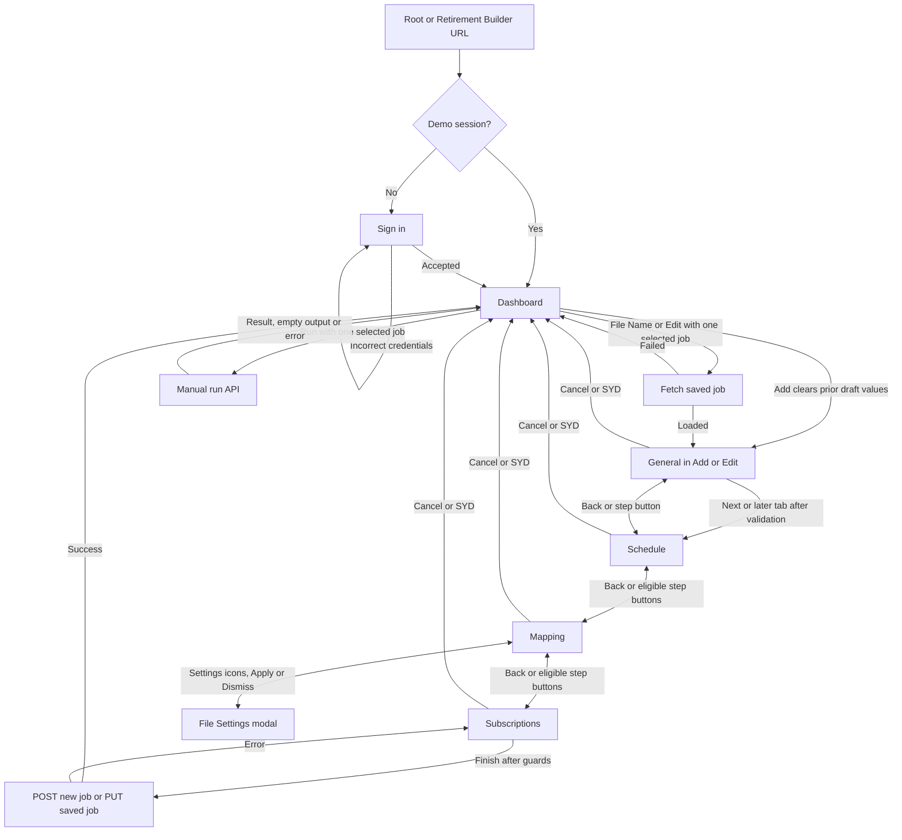

# Retirement Builder flow overview

**Baseline** 17 November 2026 (Asia/Kolkata), repository commit `6d7ce1d`, local application at `http://localhost:5174/retirement-builder`.

Retirement Builder configures payroll report exports. The wizard supplies report naming, formatting, schedule, mapping, and subscription rules. The backend reads Company Payroll Report data or a legacy CSV source, renders delimited files, records run status, and optionally stores output rows. No retirement savings, age, withdrawal, corpus, investment projection, chart, graph, or comparison calculator appears in the traced flow.

Phase 1 evidence comes from the repository and a desktop browser walkthrough of the running application. The existing payroll job shown in the list was opened for inspection. Temporary form inputs and a workbook import stayed in an unsaved draft. Save and Run were left for Phase 2. No application data, code, or SQL was changed.

## Screen and overlay inventory

| Screen type | Add route | Edit route | Sections and controls |
| --- | --- | --- | --- |
| Sign in | `/login` | Same | Email, Password, Show/Hide password, Sign in, inline sign-in error. The demo fills both fields. |
| Retirement Builder dashboard | `/retirement-builder` | Same | Template download, Add, Edit, Run, result/error area, selection checkboxes, ten sortable/filterable job columns. |
| 1. General | `/jobs/new` | `/jobs/edit/general` | File Name, File Format, Description, Output File Name Format, Store Results to Table, File workbook picker, Cancel and Next. Edit adds the Enable/Disable checkbox and a second Cancel in the card heading. |
| 2. Schedule | `/jobs/new/schedule` | `/jobs/edit/schedule` | Schedule Details, Start Date, Build Frequency, Hour, Minute, AM or PM, Week, Cancel, Back, Next. A wholly blank schedule is manual-only. |
| 3. Mapping | `/jobs/new/mapping` | `/jobs/edit/mapping` | Dataset Mapping, Include Header Row, Add Dataset, Manage dataset settings, Add mapping rule, editable mapping grid, row deletion, Cancel, Back, Next. Both icon buttons open the same settings dialog. |
| 4. Subscriptions | `/jobs/new/subscriptions` | `/jobs/edit/subscriptions` | Merge Files, Add Row, company or client selector, email entry and removable tags, row deletion, Cancel, Back, Finish, save errors. |
| File Settings | Overlay on Mapping | Same | Sorting Order and Conditional Statements grids, separate Add buttons, per-row deletion, Clear, Cancel, Save & Continue. |

There are six distinct routed screens, four wizard steps, ten concrete routes across Add and Edit, and one in-flow modal. The count excludes the root redirect, fallback shell, unrelated sidebar destinations, browser file chooser, and repeatable dropdown popovers. The shell retains its Retirement Builder navigation, SYD breadcrumb and sidebar toggle. The dashboard, mapping, subscriptions, and two settings grids supply tabular content. General and Schedule also use form groups. Result feedback is a message and links, with no result chart or summary card.

## Actual navigation

Forward clicks validate every earlier step in order, including when clicking a later tab directly. An invalid predecessor receives field alerts and becomes the active step. The General guard requires a file name and format. A blank Schedule can advance. A populated Schedule uses the date/time/frequency guards. Mapping requires at least one named row with valid numeric fields. Finish additionally validates subscription targets and email and suppresses repeated in-flight submissions. Backward clicks retain draft inputs while the app stays mounted. A valid earlier configuration can be skipped by tab navigation. On direct URLs and browser history, the route effect explicitly checks missing Edit context and the General prerequisites, while Finish still checks prior-step rules.

A refresh restored an unsaved Add draft in the same tab during discovery, including the previously selected company, email tag and Merge Files setting. Cancel returns to the dashboard and clears the session snapshot without a confirmation prompt. Browser Back reopened the canceled draft in the same mounted application and Forward returned to the dashboard. The dashboard's Add button explicitly resets form values and the create-attempt key. Unsaved changes in the File Settings modal remain inside the modal until Save & Continue. Clear only clears the modal draft and Cancel discards those changes. See [state management](06-api-and-state-management.md).

## Conditional paths

The 31 identified branches are functional decisions that change route, controls, feedback, processing, or output. Repeated option values and individual implementation conditionals are counted within their functional decision.

| ID | Decision | Outcomes |
| --- | --- | --- |
| B01 | Demo session on entry | Dashboard/wizard or sign in. |
| B02 | Demo credential comparison | Redirect to dashboard or show sign-in error. |
| B03 | Dashboard fetch outcome | Loading, populated, no match, or initial load error. |
| B04 | Dashboard selection cardinality | Edit/Run available for exactly one selected job in loaded data. Checkboxes retain filtered-out selections. |
| B05 | Dashboard sort/filter | Case-insensitive contains across columns, all filter terms must match. Sort toggles ascending/descending. |
| B06 | Add, Edit, Edit without context | Blank draft, fetched existing draft, or return to dashboard. |
| B07 | Forward validation/import in progress | Advance, return to first failing predecessor, or block while reading workbook. |
| B08 | Wizard refresh/history | Restore a matching session draft, use mounted state, or initialize defaults. |
| B09 | General mode | Enable/Disable and second header Cancel in Edit. |
| B10 | Output name format includes Client ID and source is payroll | Payroll company ID hint appears. |
| B11 | Workbook outcome | Import replaces mapping rows or shows extension, empty worksheet, or unreadable workbook error. |
| B12 | Empty versus populated schedule draft | Manual-only payload or validated schedule fields. |
| B13 | Weekly/Bi-Weekly versus Daily/Monthly | Week is required by UI for weekly variants and remains visible for all. |
| B14 | Saved start date | Edit shows blank schedule for explicit null; dashboard shows Manual only. A non-null enabled schedule can be picked up by the scheduler. |
| B15 | Source | New UI drafts use payroll; an existing CSV job uses CSV-specific selectors and source. |
| B16 | Mapping source/type changes | Format menu follows catalog/inferred type, with incompatible existing format cleared when type changes. |
| B17 | File Settings draft | Cancel/Escape/backdrop abandon changes; Clear resets draft rows; Save & Continue validates and applies them. |
| B18 | Dropdown interaction/options | Options, custom option when allowed, loading/error/no matches, select/clear/Escape/outside close. |
| B19 | Subscription row content | Empty rows omitted; populated rows require target and valid supplied emails. Email-free rows are accepted. |
| B20 | Finish outcome | Create vs update, success returns to dashboard, failure stays with error. |
| B21 | Run request source | Saved payroll procedure, configured CSV by job ID, or API CSV override when body present. |
| B22 | Run eligibility | Missing or disabled jobs rejected. An enabled job may run manually regardless of scheduled start date. |
| B23 | Output grouping | One unsplit file or partition by client/pay date, with matching H/T rows. |
| B24 | Filtering and no matches | Details retained or removed; payroll prunes corresponding trailers and returns no files when none survive. Grouped CSV also needs retained details to form files. |
| B25 | CSV headings | Include field-name line using Detail layout (or first configured layout), or omit it. |
| B26 | Store Results to Table | Persist generated data rows or leave stored count at zero. |
| B27 | Manual results UI | Counts + single/multiple download links, no generated files, or error; running status overrides the current row temporarily. |
| B28 | Scheduled time eligibility | Enabled + dated job with due slot, recheck, existing slot skip, CSV or `.complete` marker. |
| B29 | Email eligibility | Scheduled only, enabled mail and matching subscriptions, complete set of file clients/companies for each recipient. |
| B30 | Merge Files | Multiple eligible attachments for a recipient merge into one; one or none remain as-is. |
| B31 | Viewport | Collapsible desktop/sidebar layout transitions to mobile navigation, stacked form controls and scrollable grids/dialog. |

## Responsive behavior

The code initializes the sidebar open above 767 px and closed on smaller initial widths. CSS changes the sidebar into a mobile overlay, uses horizontally scrollable job/mapping and wizard step regions, stacks General and Schedule controls and the Time inputs, reduces margins/control spacing, and limits modal size with internal scrolling. Subscription controls and grid cells wrap or scroll according to width. Search menus are portalled to the body and repositioned on resize and captured scroll, opening upward when below-trigger space is tight. Source breakpoints include 1100, 900, 767, 520, and 430 px. Device, screen-reader, and breakpoint behavior were not exercised. [App.tsx](/Users/apple/Desktop/ecs/frontend/src/App.tsx:83) · [CSS viewport rules](/Users/apple/Desktop/ecs/frontend/src/styles.css:661) · [Modal sizing](/Users/apple/Desktop/ecs/frontend/src/styles.css:843)

## Discovery boundaries

- Live Add/Edit screens, payroll selectors, blank/manual Schedule, workbook field population, modal sorting and conditional values, email tags, and draft navigation were observed.
- No alternate legacy CSV job was present in the dashboard during discovery. Its save, manual-run, and custom client branches are traced in source.
- Creating/updating/running jobs, scheduled time windows, actual mail delivery, failure injection, file output edge cases, and mobile/browser compatibility are planned for Phase 2.
- No delete/duplicate job action, batch Run, chart, slider, radio group, file drag-and-drop handler, or end-user report source switch was found in this flow.

[Routing](/Users/apple/Desktop/ecs/frontend/src/main.tsx:9) · [Wizard paths](/Users/apple/Desktop/ecs/frontend/src/App.tsx:78) · [Wizard navigation](/Users/apple/Desktop/ecs/frontend/src/App.tsx:275) · [Dashboard](/Users/apple/Desktop/ecs/frontend/src/App.tsx:466) · [File Settings](/Users/apple/Desktop/ecs/frontend/src/App.tsx:859)

